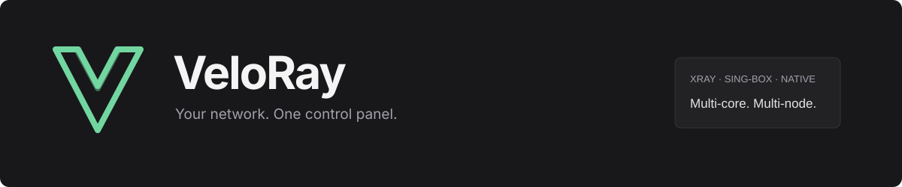
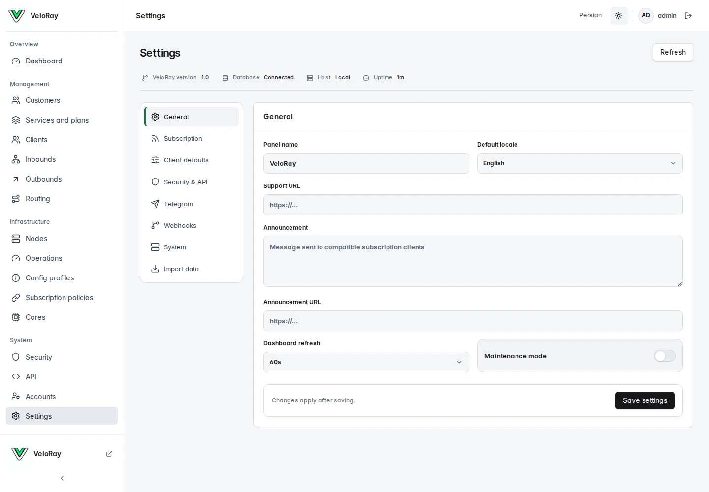
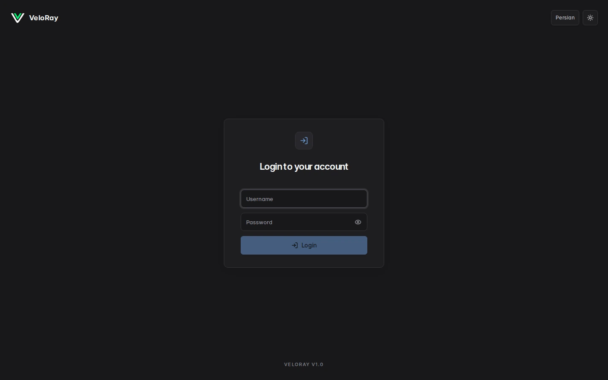
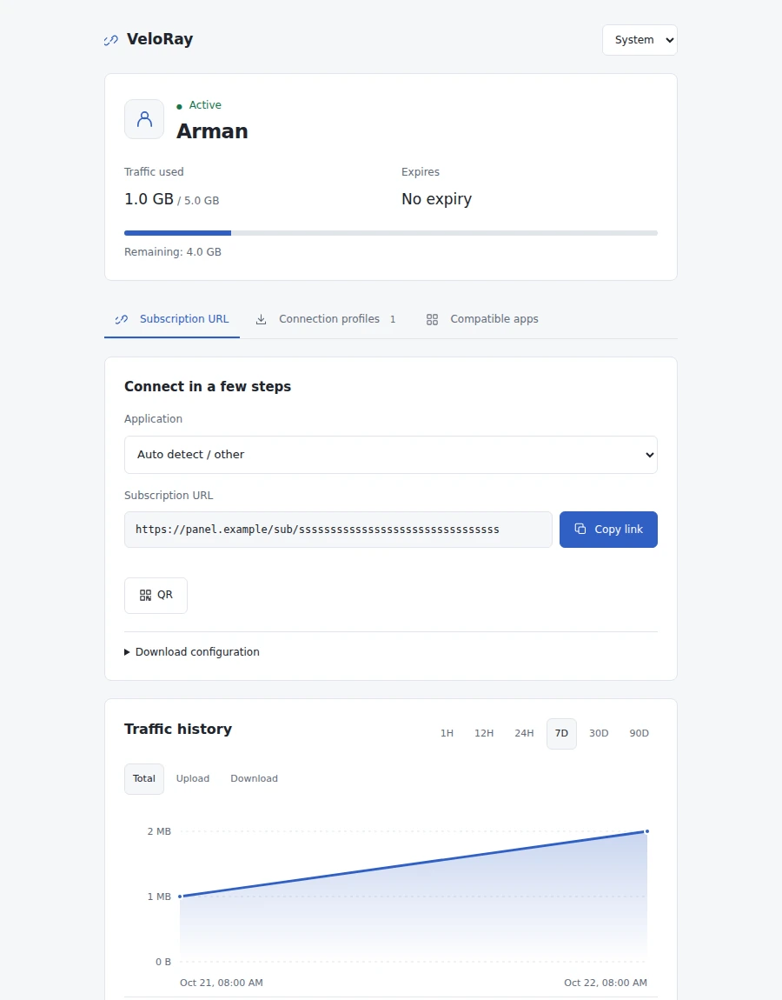

[English](README.md) · [فارسی](README.fa.md)

<p align="center"></p>

<p align="center">
<a href="https://github.com/ParsaZali/VeloRay/actions/workflows/ci.yml"></a>
<a href="LICENSE"></a>
<a href="https://github.com/ParsaZali/VeloRay/stargazers"></a>

</p>

**VeloRay پنل متن‌باز مدیریت Xray، sing-box و سرویس‌های MTProto و AmneziaWG است.** کاربران، نودها، اشتراک‌ها، مصرف و مسیریابی را در یک رابط فارسی/انگلیسی با تم روشن و تیره مدیریت کنید.

[نصب سریع](#نصب-سریع) · [تصاویر](#تصاویر) · [قابلیت‌ها](#قابلیتها) · [پروتکل‌ها](#پروتکلها) · [مستندات](#مستندات)

## نصب سریع

روی **Ubuntu 24.04** با معماری `amd64` یا `arm64` و دسترسی **root** اجرا کنید:

```bash
bash <(curl -fsSL https://raw.githubusercontent.com/ParsaZali/VeloRay/main/install.sh) --lang fa
```

روند نصب مشخص است:

1. دامنه‌ای که به سرور وصل شده یا آی‌پی عمومی سرور را وارد کنید.
2. پورت پنل و اشتراک را انتخاب کنید؛ **با Enter یک پورت آزاد تصادفی انتخاب می‌شود.**
3. برای دامنه، نصب‌کننده گواهی SSL معتبر درخواست می‌کند؛ ایمیل اختیاری است.
4. آدرس چاپ‌شده را باز کنید و با **نام کاربری و رمز تصادفی ساخته‌شده** وارد شوید.

پایگاه داده PostgreSQL، هسته‌ها، ایجنت، سرویس مستقل ساب و سرویس‌های systemd خودکار تنظیم می‌شوند. اطلاعات ورود اولیه در `/etc/veloray/install-result.env` با دسترسی مخصوص root ذخیره می‌شود. برای استفاده از بسته آماده نیازی به نصب Go یا Node.js ندارید.

برای صدور SSL دامنه باید به سرور اشاره کند و پورت ۸۰ قابل دسترس باشد. اگر صدور گواهی موفق نشود، HTTPS محلی برای دسترسی و اصلاح تنظیمات باقی می‌ماند. نصب با آی‌پی نیز از گواهی محلی استفاده می‌کند. پورت عمومی از فهرست پورت‌های CDN انتخاب نمی‌شود؛ هر پورت آزاد و مجاز سیستم را می‌توانید تعیین کنید.

### به‌روزرسانی پنل

```bash
sudo veloray update
```

آپدیت فقط بعد از سبزشدن CI همان commit در `main` انجام می‌شود. فایل نصب با هش بررسی می‌شود، قبل از تغییرات بکاپ خصوصی گرفته می‌شود و پس از نصب سلامت سرویس‌ها بررسی می‌شود. کاربران، کلیدهای رمزنگاری و اطلاعات مصرف حفظ می‌شوند. در صورت شکست نصب، بازگشت سرویس و باینری قبلی تلاش می‌شود؛ بازیابی پایگاه داده عملیاتی جداگانه است.

### حذف و نصب دوباره

دستور `sudo veloray uninstall` سرویس‌ها و فایل‌های برنامه را حذف می‌کند؛ **کاربران، کانفیگ‌های VPN، کلیدها و بکاپ‌ها حفظ می‌شوند** و با نصب دوباره برمی‌گردند. دستور `sudo veloray reset` مدیر فعلی را حتی پس از تغییر نام کاربری تشخیص می‌دهد. اگر چند مدیر دارید، با `sudo veloray admin-list` نام‌ها را ببینید و `sudo veloray reset USERNAME` را اجرا کنید.

برای نصب از صفر، دستور `sudo veloray uninstall --purge` پس از تأیید **PURGE** و ساخت بکاپ خصوصی، دیتابیس محلی پیش‌فرض، تنظیمات و کلیدها را پاک می‌کند. بکاپ‌ها باقی می‌مانند. دیتابیس سفارشی باید دستی بررسی و حذف شود.

### کنسول مدیریت

```bash
sudo veloray
```

وضعیت سرویس‌ها، گزارش‌ها، تغییر دامنه و پورت، SSL، تغییر رمز، بکاپ، تعمیر و آپدیت در یک منو در دسترس‌اند. **هنگام تغییر رمز، ورودی خالی یعنی ساخت رمز تصادفی.** موفقیت با سبز، هشدار با زرد و خطا با قرمز نمایش داده می‌شود. رنگ در خروجی غیرترمینال یا با `NO_COLOR=1` غیرفعال است.

```bash
sudo veloray status
sudo veloray doctor
sudo veloray admin-list
sudo veloray reset
sudo veloray domain panel.example.com
sudo veloray port 23456
sudo veloray ssl admin@example.com
sudo veloray backup
sudo veloray auto-update enable
```

نصب ایجنت روی سرور جداگانه:

```bash
bash <(curl -fsSL https://raw.githubusercontent.com/ParsaZali/VeloRay/main/install.sh) node --lang fa
```

## تصاویر

این تصاویر با حساب‌های نمایشی تهیه شده‌اند و حاوی اطلاعات کاربران واقعی نیستند.

<picture><source media="(prefers-color-scheme: dark)" srcset="docs/media/settings-dark.webp"></picture>

<details><summary>صفحه ورود و صفحه پیش‌فرض اشتراک</summary>




</details>

## قابلیت‌ها

| بخش | امکانات |
|---|---|
| کاربران و مشتریان | حساب مشترک بین چند نود، حجم، انقضا، شروع با اولین اتصال، تمدید دوره‌ای، محدودیت IP/HWID و عملیات گروهی |
| نودها | نود محلی و جداگانه، اعتبارسنجی تنظیمات، بررسی پورت، ثبت عملیات و بازگشت پس از شکست اعمال تنظیمات |
| اشتراک | صفحه ساده پیش‌فرض، HTML سفارشی، مسیر قابل تغییر، پورت مستقل HTTPS، QR و خروجی مخصوص برنامه‌ها |
| مدیریت هسته | دانلود اختیاری نسخه رسمی گیت‌هاب، انتخاب نسخه پایدار، تأیید SHA-256، بررسی تنظیمات و بازگشت به نسخه قبلی |
| GeoIP / Geosite | دریافت از مخزن رسمی v2fly، تأیید هش، بررسی کامل با Xray، جایگزینی اتمیک و بازگشت به فایل قبلی |
| مصرف | شمارنده پایدار، مصرف واقعی آپلود/دانلود، ضریب حجم، نمودار، CSV و آمار خروجی‌ها |
| شبکه | ورودی و خروجی، قواعد مسیریابی، زنجیره‌سازی، fallback و balancing در Xray و selector/URL-test در sing-box |
| تست اتصال | آزمایش با اطلاعات واقعی کاربر و نود انتخاب‌شده و اندازه‌گیری تأخیر |
| دسترسی | مدیر، ریسلر، بیننده، نقش سفارشی، بودجه حساب و کلید API با دسترسی محدود |
| ورود | رمز محلی، احراز هویت دومرحله‌ای، کد بازیابی و ورود اختیاری OIDC، گیت‌هاب، Telegram OIDC و LDAPS |
| مانیتورینگ | بررسی سلامت، عیب‌یابی، بودجه میزبانی، دوره مصرف ماهانه، Prometheus و تاریخچه فعالیت |
| خودکارسازی | تلگرام، وب‌هوک امضاشده، اعلان Discord و ایمیل و بکاپ زمان‌بندی‌شده |
| رابط کاربری | React با بارگذاری جداگانه صفحات، فارسی و انگلیسی، تاریخ شمسی/میلادی، فونت محلی، تم روشن/تیره و PWA |

## پروتکل‌ها

| هسته | پروتکل‌های قابل مدیریت |
|---|---|
| Xray | VLESS، VMess، Trojan، Shadowsocks، Hysteria2، WireGuard، HTTP، SOCKS، Tunnel و TUN |
| sing-box | VLESS، VMess، Trojan، Shadowsocks، Hysteria2، TUIC v5، Snell v6، Naive TLS، ShadowTLS v3، HTTP و SOCKS |
| VeloRay Native | MTProto/FakeTLS و AmneziaWG با حسابداری، انقضا و لغو دسترسی مستقل هر کاربر |

ترنسپورت‌های TCP/raw، WebSocket، gRPC، XHTTP، HTTPUpgrade، mKCP و QUIC در ترکیب‌های پشتیبانی‌شده در دسترس‌اند. TLS و REALITY نیز برای ترکیب‌های سازگار ارائه می‌شوند. TUN و WireGuard ممکن است به دسترسی شبکه میزبان نیاز داشته باشند. AmneziaWG داخلی برای ترافیک عمومی TCP/UDP از شبکه کاربری استفاده می‌کند.

تغییر کاربران سرویس‌های Native، اتصال کاربران تغییریافته‌نشده را حفظ می‌کند. Xray افزودن زنده کاربر روی ورودی ثابت VLESS/VMess/Trojan را پشتیبانی می‌کند؛ تغییرات ساختاری دیگر با اعتبارسنجی و راه‌اندازی مجدد اعمال می‌شوند.

## اشتراک مطابق تنظیمات شما

```text
https://vpn.example.com:23457/sub/USER_TOKEN
https://vpn.example.com:23457/access/USER_TOKEN
https://vpn.example.com:23457/USER_TOKEN
```

در **تنظیمات ← اشتراک ← مسیر اشتراک**، مسیر دلخواه را وارد کنید یا برای قرارگرفتن توکن در ریشه، ورودی را خالی بگذارید. تغییر مسیر، لینک قبلی را تغییر می‌دهد ولی توکن کاربر ثابت می‌ماند. پورت مستقل HTTPS نیز از همین بخش قابل مدیریت است؛ لینک‌ها بعد از موفقیت راه‌اندازی پورت جدید به آن منتقل می‌شوند.

خروجی raw، Base64، Clash/Mihomo، sing-box و Xray در کنار فایل WireGuard/AmneziaWG و لینک تلگرام ارائه می‌شود. اشتراک چندپروتکلی، اعضای سازگار با فرمت انتخاب‌شده را نگه می‌دارد. برای HTML دلخواه، **فایل HTML سفارشی** را انتخاب و مسیر فایل داخل `/etc/veloray/templates` را ثبت کنید.

## هسته‌های رسمی

در **هسته‌ها ← نسخه هسته‌ها**، دانلود رسمی را فعال و نسخه پایدار دلخواه را انتخاب کنید. منابع فقط `XTLS/Xray-core` و `SagerNet/sing-box` هستند. هش رسمی آرشیو، معماری و تنظیمات جاری قبل از تعویض بررسی می‌شوند. فعال‌کردن دانلود به معنی آپدیت خودکار زمان‌بندی‌شده نیست.

نسخه همراه VeloRay از sing-box، اطلاعات تکمیلی IP هر کاربر دارد؛ تعویض آن با باینری رسمی هنگام وجود محدودیت IP رد می‌شود. هسته‌های کانتینری با ایمیج به‌روز می‌شوند. [جزئیات مدیریت هسته](docs/core-versions.md)

## مستندات

- [حساب مشتری و پلن‌ها](docs/customer-management.md)
- [قالب و خروجی اشتراک](docs/subscription-customization.md)
- [پورت مستقل ساب](docs/independent-subscriptions.md)
- [MTProto و AmneziaWG](docs/mtproto-and-amneziawg.md)
- [مدیریت نسخه هسته](docs/core-versions.md)
- [تست اتصال](docs/client-connection-tests.md)
- [Docker و cloud-init](docs/container-deployment.md)
- [عملیات و اعلان‌ها](docs/operations-and-alerts.md)
- [امکانات تحویل‌شده و نقشه راه](docs/competitor-parity-roadmap.md)

مرجع REST/OpenAPI از بخش **API** پنل قابل مشاهده است. وضعیت CI شامل تست Go و race، PostgreSQL، هسته‌های ثابت، مرورگر، PWA، نصب و استقرار واقعی Docker است. بسته‌های هر دو معماری باید با manifest سورس تطابق داشته باشند.

VeloRay با مجوز MIT منتشر می‌شود؛ هسته‌ها و وابستگی‌ها مجوز و اعلان‌های خود را حفظ می‌کنند. برای کمک به پروژه، [ستاره بدهید](https://github.com/ParsaZali/VeloRay) یا اشکالی قابل بازتولید، بدون اطلاعات حساس، گزارش کنید.


### فروش و قابلیت‌های مدیریتی جدید

از «سرویس‌ها و پلن‌ها ← فروش و حسابداری» می‌توانید بستهٔ فروش، فروشگاه، کیف پول و دفتر تراکنش‌ها را مدیریت کنید. پرداخت زرین‌پال فقط پس از تأیید سرور ثبت می‌شود. تمدید، لینک ساب و مصرف قبلی را حفظ می‌کند؛ تحویل ناموفق قابل تلاش مجدد است. پرداخت آزمایشی اعتبار واقعی یا حساب مشتری نمی‌سازد.

بخش «تیم» برای ریسلرهای زیرمجموعه، سهمیهٔ ارث‌بری‌شده و انتقال اعتبار والد به فرزند است. سفارش‌های منتظر پرداخت نیز ظرفیت رزرو می‌کنند. در تنظیمات فروشگاه می‌توانید نام، لوگو، پشتیبانی و دامنهٔ اختصاصی ساب هر فروشنده را تعیین کنید؛ دامنه پس از تأیید DNS، HTTPS و اتصال به همین پنل فعال می‌شود.

- [راهنمای فروش، پرداخت و کیف پول](docs/commerce.md)
- [ربات فروش تلگرام، مینی‌اپ و پرداخت استارز](docs/telegram-sales.md)
- [ورود با Passkey و بازیابی کلیدهای مدیر](docs/passkeys.md)
- [به‌روزرسانی GeoIP و Geosite و بازگشت نسخه](docs/geo-updates.md)
- [فریز اشتراک و پیش‌نمایش اثر تغییر سرویس](docs/customer-freeze-and-impact.md)
- [اتصال نود با دستور یک‌بارمصرف و تأیید گواهی](docs/node-enrollment.md)
- [پنل فعال و آماده‌به‌کار](docs/panel-availability.md)
- [Shadowsocks 2022 چندکاربره](docs/shadowsocks-2022.md)
- [وضعیت دقیق توسعه و موارد باقی‌مانده](docs/expansion-roadmap.md)
